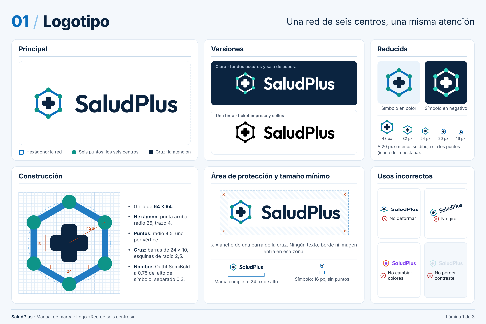
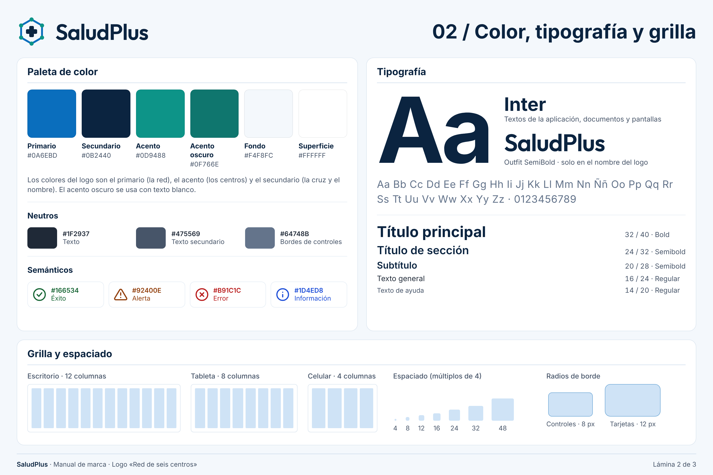
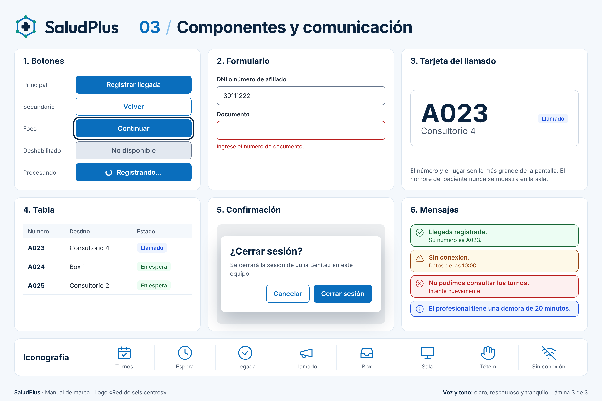

# Marca SaludPlus

Logo «Red de seis centros». El dibujo de referencia es el componente [`Logo.tsx`](../../frontend/src/componentes/Logo.tsx): las láminas y los archivos de esta carpeta salen de ese mismo dibujo.

## Qué representa

- **Hexágono:** la red.
- **Seis puntos:** los seis centros médicos.
- **Cruz:** la atención, la misma en cualquier centro.

## Construcción

- Grilla de 64 × 64 unidades.
- Hexágono con punta arriba, radio 26, trazo 4. Vértices: 32,6 · 54.52,19 · 54.52,45 · 32,58 · 9.48,45 · 9.48,19.
- Puntos de radio 4,5 en cada vértice.
- Cruz de dos barras de 24 × 10, esquinas de radio 2,5.
- Nombre en Outfit SemiBold, de un alto de letra igual a 0,75 del símbolo, separado 0,3 del símbolo.

## Colores

| Parte | Versión principal | Versión clara (fondo #0B2440) |
|---|---|---|
| Hexágono | #0A6EBD | #FFFFFF |
| Puntos | #0D9488 | #2DD4BF |
| Cruz y nombre | #0B2440 | #FFFFFF |

La versión de una tinta usa un solo color (negro en el ticket impreso).

## Reglas

- **Área de protección:** el ancho de una barra de la cruz, alrededor de todo el logo.
- **Tamaño mínimo:** 24 px de alto para el logo completo y 16 px para el símbolo.
- **20 px o menos:** el símbolo se dibuja sin los puntos y con trazo 5 (ver [`favicon.svg`](../../frontend/public/favicon.svg)).
- **No:** deformar, girar, cambiar los colores, mover o quitar los puntos, agregar sombras o degradados, ni ponerlo sobre fondos sin contraste.

## Archivos

| Archivo | Uso |
|---|---|
| `logo-principal.png` | Logo completo, fondo transparente. |
| `logo-clara.png` | Logo completo para fondos oscuros. |
| `logo-una-tinta.png` | Logo en negro, para impresión. |
| `simbolo.svg`, `simbolo-claro.svg`, `simbolo-una-tinta.svg` | Solo el símbolo, en vectores. |
| `01-logotipo.png` | Lámina del logo. |
| `02-color-tipografia-grilla.png` | Lámina de color, tipografía y grilla. |
| `03-componentes-comunicacion.png` | Lámina de componentes y mensajes, con los estilos reales del sistema. |

## Láminas

